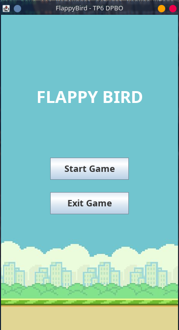
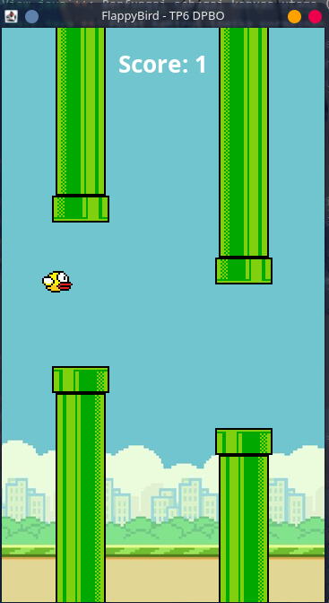
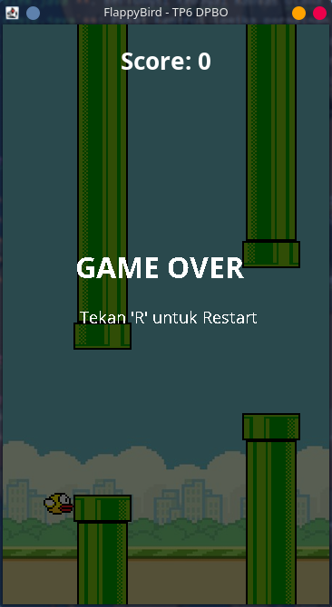

## TP6DPBO2526C2

## Janji
Saya Rhafa Farell Valeno dengan NIM 2508020 mengerjakan Tugas Praktikum 6 dalam mata kuliah Desain dan Pemrograman Berorientasi Objek untuk keberkahan-Nya maka saya tidak melakukan kecurangan seperti yang telah dispesifikasikan. Aamiin.

---

## Desain Program
Aplikasi permainan **Flappy Bird** ini dikembangkan menggunakan bahasa pemrograman Java dengan kerangka kerja antarmuka grafis **Java Swing**. Arsitektur program dirancang terpisah antara komponen model, kontroler logika, dan tampilan visual untuk menjaga keteraturan struktur kode:

- **`App.java`**: Menjadi titik masuk (*entry point*) utama program yang menginisialisasi `JFrame` dan mengelola navigasi antar panel menggunakan `CardLayout`.
- **`MainMenu.java`**: Mengelola antarmuka menu awal yang terdiri dari tombol *Start Game* dan *Exit Game*.
- **`View.java`**: Berfungsi sebagai kanvas utama (`JPanel`) yang merender seluruh aset visual (pemain, pipa rintangan, latar belakang) serta menampilkan `JLabel` untuk skor permainan.
- **`Logic.java`**: Pusat kontrol logika permainan yang menangani simulasi gravitasi, timer perulangan frame (*game loop*), pergerakan rintangan, kalkulasi skor, deteksi benturan (*collision detection*), serta fitur *restart*.
- **`Player.java`**: Model objek pemain (burung) yang menyimpan posisi, ukuran, kecepatan vertikal, dan *bounding box* untuk deteksi area benturan.
- **`Pipe.java`**: Model objek rintangan (pipa) yang menyimpan posisi, ukuran, status lewati (*passed*), dan *bounding box*.
- **`Sound.java`**: Modul pembantu untuk memutar musik latar belakang (*BGM*) dan efek suara (*SFX*) berbasis `javax.sound.sampled`.

---

## Penjelasan Alur Permainan

1. **Awal Permainan (Main Menu)**: Saat aplikasi dijalankan, pemain dihadapkan pada layar menu utama. Pemain dapat memilih tombol **Start Game** untuk memulai atau **Exit Game** untuk menutup aplikasi.
2. **Gameplay & Kontrol**: Setelah memilih *Start Game*, musik latar (*BGM*) mulai terputar secara berulang. Pemain menekan tombol **Spasi** untuk membuat burung melompat melawan pengaruh gravitasi.
3. **Pipa & Perhitungan Skor**: Pasangan pipa atas dan bawah akan muncul secara berkala dari sebelah kanan layar. Setiap kali burung berhasil melintasi sepasang pipa, nilai pada `JLabel` skor bertambah 1 dan efek suara skor dipicu.
4. **Kondisi Game Over**: Apabila burung menyentuh pipa atau jatuh ke dasar layar, *game loop* dan pemunculan pipa dihentikan, musik BGM dimatikan, dan efek suara benturan diputar bersamaan dengan munculnya overlay teks *"GAME OVER"*.
5. **Restart Permainan**: Di layar *Game Over*, pemain cukup menekan tombol **R** untuk mereset posisi burung, mengosongkan daftar pipa, mengembalikan skor ke angka 0, dan memulai kembali permainan.

---

## Struktur Direktori

```text
TP6DPBO2526C2/
├── assets/                     # Folder aset media (gambar & audio)
│   ├── background.png
│   ├── bird.png
│   ├── lowerPipe.png
│   ├── upperPipe.png
│   ├── bgm.wav
│   ├── jump.wav
│   ├── score.wav
│   └── hit.wav
├── Dokumentasi/                # Folder simpanan bukti pengujian program
│   ├── main_menu.png
│   ├── gameplay.png
│   ├── gameover.png
│   └── gameplay.webm
├── src/                        # Kode sumber Java Class
│   ├── App.java
│   ├── Logic.java
│   ├── MainMenu.java
│   ├── Pipe.java
│   ├── Player.java
│   ├── Sound.java
│   └── View.java
├── README.md
└── TP6DPBO2526C2.iml
```

---

## Dokumentasi Program

### Screenshots
- **Main Menu**  
  

- **Gameplay & Skor**  
  

- **Game Over & Screen Restart**  
  

